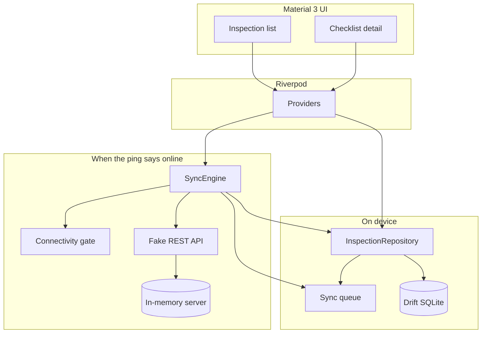

# SiteCheck

Offline-first field inspection checklists. An inspector can open a site visit, work through a pass / fail / N/A list, and keep editing with no network. Edits land in a local Drift (SQLite) database and a sync queue. When the device is back online, the queue pushes each inspection to an in-memory REST fake. If the server row changed since this device last synced, last-write-wins keeps the newer `updatedAt` and the losing device raises a conflict flag.

This is a portfolio demo for Arpan Bom's CV. The backend is fake, there is no account system, and there are no measured latency or reliability numbers.

## Architecture



The fake server exposes the same shapes a small REST API would:

- `GET /health`
- `GET /inspections`
- `PUT /inspections/:id` with `{ baseUpdatedAt, inspection }`
- `DELETE /inspections/:id` with the same body

A conflict is a push whose `baseUpdatedAt` does not match the stored server `updatedAt`. The later timestamp wins. A tie keeps the write that is pushing. The device stores `conflictFlag` and a short explanation. Dismiss clears the flag only. The losing write is not kept for a manual merge.

The fake server trusts client-supplied timestamps. A real backend would not.

The cloud icon in the app bar simulates airplane mode. A separate ping of `GET /health` is the server reachability check, polled every few seconds while the app is running.

## Run

Install the Flutter stable SDK (Dart 3) and SQLite headers on Linux (`libsqlite3-dev`, which provides `libsqlite3.so`).

```bash
flutter pub get
flutter run
```

Generated Drift code is already in the repo. After a schema change:

```bash
dart run build_runner build --delete-conflicting-outputs
```

The first launch seeds four sample visits, including one with the conflict flag already set so that state is visible. Sample data is not a live dispute with another device.

## Test

```bash
flutter analyze
flutter test
```

Tests cover the repository, the sync queue and sync engine (including both last-write-wins outcomes), and the list and detail screens. They use an in-memory database and the fake server. No emulator, device, or browser is required.

## Measurements

Sync latency, database size, and conflict rate are not measured here.

Placeholder: add numbers only after a run against a real backend.

## License

MIT. See [LICENSE](LICENSE).
